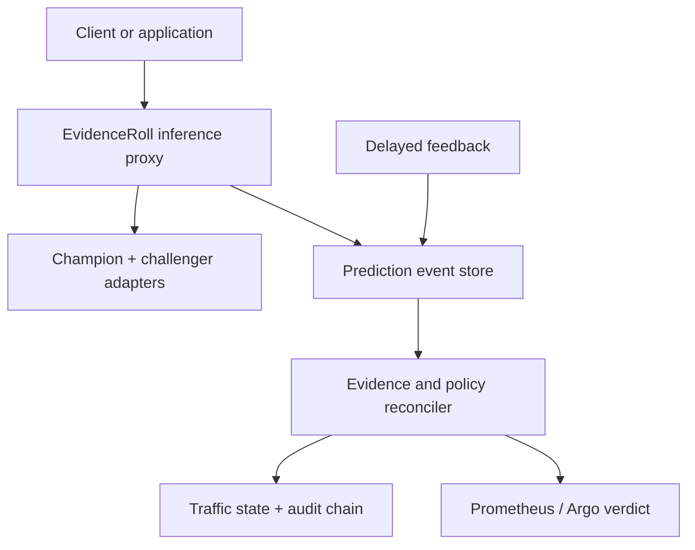
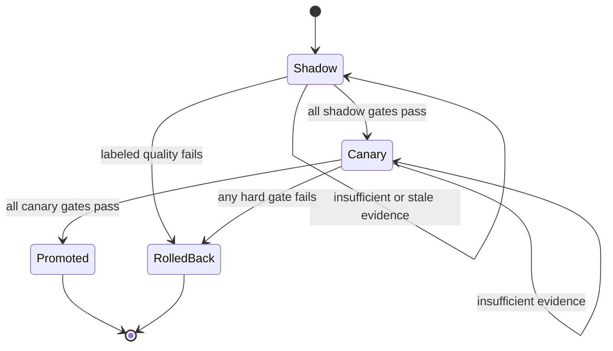

# EvidenceRoll

[](https://github.com/MarckMorris/evidenceroll/actions/workflows/ci.yml)
[](https://www.python.org/downloads/)
[](LICENSE)

**Evidence-aware progressive delivery for ML models when ground truth arrives late.**

A release is not healthy merely because nothing failed. EvidenceRoll shadows a challenger against
the current champion, joins outcomes when they eventually arrive, and turns operational health,
feature shift, model disagreement, paired quality, calibration, freshness, and coverage into one
auditable action: `HOLD`, `START_CANARY`, `PROMOTE`, or `ROLLBACK`.

No cloud account, external API, or GPU is required to prove the complete workflow locally. The same
control plane can score generic HTTP and KServe V2 endpoints and expose its verdict to Argo Rollouts.

> **Start here:** [complete explanation, architecture diagrams, and step-by-step workflow](docs/project-walkthrough.md)

---

## The blind spot

Ordinary progressive delivery answers: *is the new service responding?* Production ML also needs to
answer: *is the new decision function safe, and do we have enough evidence to know?*

That second question is difficult when a conversion, fraud outcome, repayment, churn event, or human
review arrives hours or weeks after inference. A canary may finish while its quality is still unknown.
Missing evidence then becomes indistinguishable from good evidence.

EvidenceRoll makes **evidence sufficiency** a control-plane state:

- no minimum sample → `HOLD`;
- stale evidence → `HOLD`;
- too few or selectively missing labels → `HOLD`;
- operational, drift, disagreement, quality, or calibration breach → `HOLD` or `ROLLBACK` according
  to exposure;
- fresh, sufficient, non-inferior shadow evidence → `START_CANARY`;
- fresh, sufficient, non-inferior canary evidence → `PROMOTE`.

The design is fail-closed: absence of evidence can never produce promotion.

## What is different

KServe provides model serving and traffic splitting. Argo Rollouts provides generic metric-driven
progressive delivery. MLflow provides model identity and aliases. Monitoring libraries calculate
signals. EvidenceRoll is the thin decision layer between them: it evaluates the **release delta**,
models delayed feedback explicitly, preserves an evidence packet, and emits a machine-actionable
verdict.

It is designed to complement those systems, not replace them.

## Architecture



The challenger is evaluated on the same observations as the champion. During `shadow`, only the
champion response reaches the caller. During `canary`, a stable SHA-256 bucket assigns a configured
percentage of entities to the challenger, so one entity does not oscillate between models.

## Release workflow



Every decision records the policy ID and digest, metric values, sample counts, freshness, reason
codes, resulting stage, and an evidence digest. Audit events form a SHA-256 hash chain; set
`EVIDENCEROLL_AUDIT_HMAC_KEY` to make the chain keyed.

## Three-minute proof

```bash
python -m venv .venv
source .venv/bin/activate             # Windows: .venv\Scripts\activate
python -m pip install -e ".[dev]"

# Healthy challenger: shadow -> canary -> promoted
python -m evidenceroll.cli simulate --scenario healthy --reset

# Regressed challenger: rejected with labeled evidence
python -m evidenceroll.cli simulate --scenario regressed --reset

# Missing feedback: held, never treated as success
python -m evidenceroll.cli simulate --scenario missing-feedback --reset

# Shifted inputs: held before customer exposure
python -m evidenceroll.cli simulate --scenario covariate-shift --reset
```

The fixtures train real scikit-learn pipelines and send paired predictions through the same service,
store, policy, controller, and audit code used by the API. Their data is deliberately synthetic: this
proves system behaviour, not business or model validity.

Run the declared comparison corpus:

```bash
python -m evidenceroll.cli benchmark --output benchmark-results.json
```

| Authored scenario | Expected | EvidenceRoll | HTTP-only canary |
|---|---|---|---|
| Healthy challenger | promote | promote | promote |
| Labeled regression | rollback | rollback | promote |
| Missing feedback | hold | hold | promote |
| Covariate shift | hold | hold | promote |

Result on the deterministic corpus: EvidenceRoll `4/4`; HTTP-health-only baseline `1/4`. This is an
acceptance benchmark over declared test cases, not evidence of universal superiority.

## Run the control plane

```bash
python -m evidenceroll.cli init
python -m evidenceroll.cli serve
```

- Dashboard: <http://localhost:8080>
- OpenAPI: <http://localhost:8080/docs>
- Prometheus: <http://localhost:8080/metrics>
- Health/readiness: `/healthz`, `/readyz`

Create a release:

```bash
curl -sS -X POST http://localhost:8080/v1/releases \
  -H 'Content-Type: application/json' \
  -d '{
    "release_id": "churn-2026-09",
    "champion_version": "champion",
    "challenger_version": "challenger-good"
  }'
```

Send a prediction. Use `Idempotency-Key` on retried writes:

```bash
curl -sS -X POST http://localhost:8080/v1/predictions \
  -H 'Content-Type: application/json' \
  -H 'Idempotency-Key: checkout-88421' \
  -d '{
    "release_id": "churn-2026-09",
    "entity_id": "customer-42",
    "features": {
      "sessions_30d": 8,
      "avg_order_value": 55,
      "days_since_last_order": 21,
      "support_tickets": 2,
      "discount_ratio": 0.25
    }
  }'
```

When the outcome exists, join it using the returned `prediction_id`:

```bash
curl -sS -X POST http://localhost:8080/v1/feedback \
  -H 'Content-Type: application/json' \
  -d '{"prediction_id":"pred-...","label":1}'

curl -sS -X POST http://localhost:8080/v1/releases/churn-2026-09/reconcile
```

## Connect real model endpoints

The local artifacts are an acceptance harness, not a deployment requirement. Register a remote
KServe V2 model without placing credentials in the registry:

```bash
python -m evidenceroll.cli register-endpoint challenger-42 \
  --registry .evidenceroll/registry \
  --provider kserve_v2 \
  --endpoint https://models.internal/v2/models/challenger-42/infer \
  --bearer-token-env MODEL_ENDPOINT_TOKEN
```

Or use `--provider generic_http` for the documented JSON contract. See
[integrations](docs/integrations.md) for payloads, credentials, Argo analysis, and the production
cutover procedure. The [operations guide](docs/operations.md) defines service objectives, capacity
tests, backup/restore, deployment gates, and change management.

## Containers and Kubernetes

Local observability stack:

```bash
docker compose up --build
```

This starts EvidenceRoll, Prometheus, a provisioned alert set, and a Grafana dashboard. The Compose
password is intentionally local-only and must not be reused.

Cloud-portable baseline:

```bash
kubectl apply -k deploy/kubernetes/base
kubectl apply -f deploy/kubernetes/argo-analysis-template.yaml  # when Argo is installed
```

The baseline runs one controller replica with `Recreate` and a `ReadWriteOnce` volume because the
included store is SQLite. That boundary is deliberate and enforced in the manifests. See
[ADR-003](docs/adr/003-single-writer-store.md) before adapting the control plane for HA.

## Policy as code

All thresholds live in [`config/policy.yaml`](config/policy.yaml). Unknown keys and impossible
relationships fail validation. A policy digest is attached to every evidence packet, so a later
threshold edit cannot silently change what an older decision meant.

The default policy is an executable example, not a universal safe value. Calibrate it on replayed
traffic and business costs before deployment.

## Security and integrity

- non-root container, read-only root filesystem, dropped Linux capabilities;
- optional constant-time API-key check on mutation endpoints;
- remote credentials referenced by environment-variable name, never written to registry metadata;
- SHA-256 verification before local model deserialization;
- optional HMAC-SHA-256 audit chain;
- request/feedback idempotency and conflict detection;
- optimistic revision checks prevent two reconcilers from committing stale transitions;
- NetworkPolicy, probes, resource limits, dependency audit, and container build in CI.

A digest proves artifact integrity against the manifest; it does not prove publisher identity.
Review [SECURITY.md](SECURITY.md) and the [threat model](docs/threat-model.md) before exposing the API.

## Verification

```bash
./scripts/verify.sh
```

The repository's verification contract includes:

- unit tests for policy, statistics, routing, registry and storage;
- integration tests for API, feedback join and full state transitions;
- four executable failure/acceptance scenarios;
- artifact tamper, audit-chain tamper, idempotency and concurrency tests;
- Ruff formatting/lint and strict mypy;
- branch-aware coverage with an `88%` hard floor;
- wheel/sdist build and dependency vulnerability audit;
- CI on Python 3.10, 3.11 and 3.12 plus an isolated container build.

The latest locally reproduced evidence is recorded in [VALIDATION.md](VALIDATION.md). Live Docker
and Kubernetes checks are not claimed where no runtime was available.

The [GitHub publishing guide](docs/github-publishing.md) provides the repository metadata, first-push
commands, branch protection, topics, and profile-positioning steps.

## Repository map

```text
src/evidenceroll/       API, adapters, evidence engine, policy, routing and persistence
tests/                  unit, integration, contract and scenario tests
config/                 versioned release policy
deploy/kubernetes/      cloud-portable Kustomize baseline and Argo gate
observability/          Prometheus rules and provisioned Grafana dashboard
docs/                   research, walkthrough, operations, threat model, ADRs and runbooks
scripts/                deterministic acceptance and full verification entry points
evidence/               declared synthetic acceptance results
```

## Explicit boundaries

Version `0.1.0` is complete for one binary probabilistic classification release at a time per
controller instance. It is not:

- a proof that PSI implies harmful concept drift;
- a substitute for experiment design or causal business measurement;
- a multi-tenant authorization system;
- an HA database or global traffic controller;
- a regulated sequential-testing implementation;
- a guarantee that a deserialized third-party model is safe;
- a claim of production scale based on synthetic traffic.

Those boundaries make the evidence legible. The [roadmap](ROADMAP.md) separates validated behaviour
from future distributed-system work.

## Research basis

The problem selection and tool-boundary analysis are documented in
[docs/research.md](docs/research.md). Key sources include the
[Google ML Test Score](https://research.google/pubs/the-ml-test-score-a-rubric-for-ml-production-readiness-and-technical-debt-reduction/),
[current practitioner research](https://arxiv.org/html/2509.25195v1),
[KServe canary documentation](https://kserve.github.io/website/docs/model-serving/predictive-inference/rollout-strategies/canary),
[Argo Rollouts analysis](https://argo-rollouts.readthedocs.io/en/stable/features/analysis/), and
[NannyML's documented label-free estimation assumptions](https://nannyml.readthedocs.io/en/stable/how_it_works/performance_estimation.html).

## License

MIT. See [LICENSE](LICENSE).
