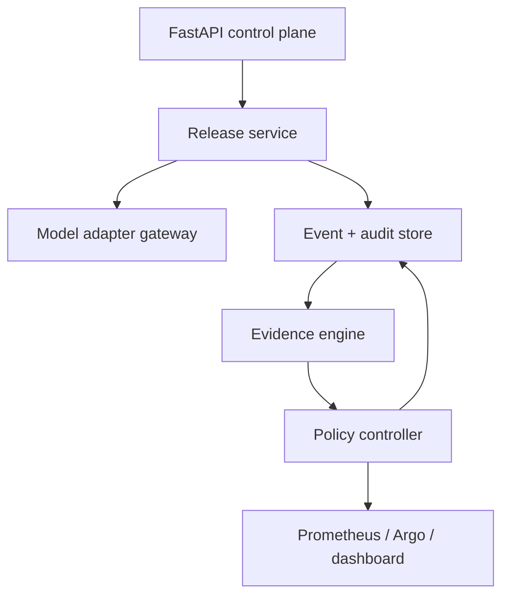
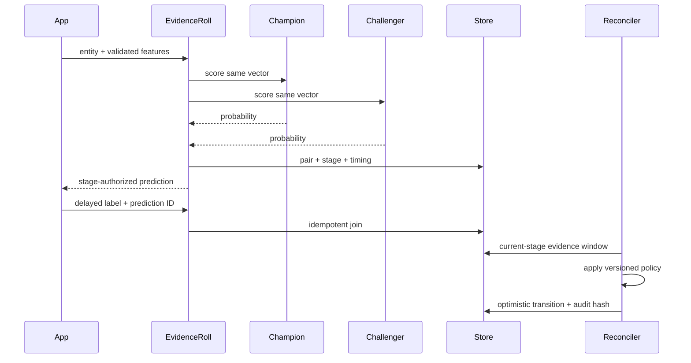

# Architecture

## Design objective

EvidenceRoll is a release control plane and inference proxy for one champion/challenger comparison.
It separates three questions that are commonly collapsed:

1. **Can the model answer?** Adapter and latency evidence.
2. **Is the model behaving differently?** Paired outputs and feature-profile evidence.
3. **Do we know enough to change exposure?** Label volume, coverage, freshness, quality and policy.

Only the third question can authorize promotion.

## Components

### API

Validates finite numeric feature maps and checks their exact names against the active registry,
validates feedback contracts, supports idempotent prediction writes, optionally protects mutations
with an API key, and publishes OpenAPI. Operational endpoints are separate from mutations.

### Adapter gateway

The gateway selects an adapter by model-version metadata:

- `joblib`: verified local scikit-learn-compatible artifact;
- `generic_http`: named-feature JSON request and one probability response;
- `kserve_v2`: FP64 tensor request using the V2 inference protocol.

Remote secrets are referenced by environment-variable name. Endpoint configuration is trusted
administrator input; it is not accepted through the public API.

### Event store

The store persists releases, prediction pairs, late feedback, and decision events. A release state
transition and its decision audit event commit in the same SQLite transaction. Prediction rows
retain the release stage at inference time, so shadow and canary evidence are never accidentally
pooled. Feedback has a unique key on `prediction_id`; duplicate identical labels are idempotent and a
different second label is a conflict.

Release updates use an optimistic revision. A reconciler that evaluated revision `n` cannot commit
after another reconciler already produced revision `n+1`.

### Evidence engine

For the active stage window, the engine calculates:

- number of predictions, labels, coverage and latest-event age;
- per-feature population stability index against a training profile;
- champion/challenger disagreement and confidence delta;
- p95 adapter latency for both models;
- paired accuracy delta and approximate 95% interval;
- Brier score delta and ROC AUC when both classes are present.

The interval is a transparent normal approximation over paired correctness deltas. It is not a
regulated or always-valid sequential test. Production users must choose statistical methods that
match their repeated-testing plan and risk.

### Policy controller

The controller is a pure function from `(release, evidence, policy)` to `EvidenceReport`. This keeps
the core decision deterministic and testable. Side effects occur only after the report exists.

Evaluation order is intentional:

1. terminal-stage protection;
2. prediction volume;
3. operational and feature-shift hard gates;
4. label volume, coverage, and labeled-evidence freshness;
5. labeled non-inferiority and calibration;
6. disagreement guardrail;
7. stage transition.

When labels are sufficient, a labeled regression can reject a challenger even if proxy disagreement
is also high. When labels are absent, disagreement can block but cannot prove harm.

### Audit chain

Each audit event hashes canonical JSON containing the event, previous hash and timestamp. The next
event commits to that hash. With no key, this detects accidental or unsophisticated modification.
With `EVIDENCEROLL_AUDIT_HMAC_KEY`, recomputing a valid chain additionally requires the key.

This is not an external transparency log: an attacker with database and key access can rewrite it.
Export the chain head to an independent system for stronger non-repudiation.

## Data flow

## Failure semantics

| Failure | API behavior | Release behavior |
|---|---|---|
| model endpoint timeout/error | request fails; no fabricated prediction | no evidence event; alert at platform layer |
| invalid probability | request fails closed | no routing decision |
| duplicate request with same idempotency key/body | original response is replayed | no duplicate event |
| same key with different body | `409` | unchanged |
| label for missing prediction | `404` | unchanged |
| conflicting second label | `409` | original label retained |
| stale/insufficient evidence | valid `HOLD` decision | no exposure increase |
| concurrent stale reconciler | `409` transition conflict | newer revision wins |
| artifact digest mismatch | release creation/inference fails | artifact is not loaded |
| audit-chain mismatch | integrity endpoint reports failed event | incident runbook applies |

## Deployment topology

Version `0.1.0` intentionally runs one writer. Docker Compose uses a named data volume. Kubernetes
uses one replica, `Recreate`, and a `ReadWriteOnce` PVC. Remote model endpoints may scale
independently. See [ADR-003](adr/003-single-writer-store.md) for the HA migration boundary.
