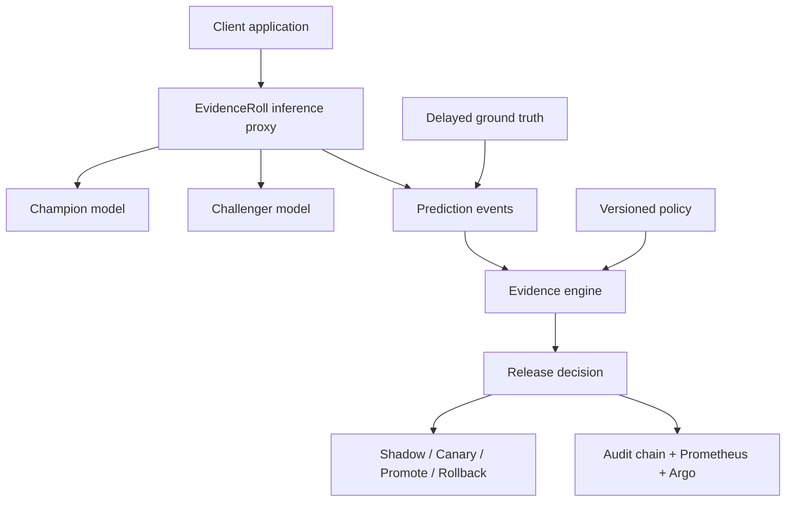
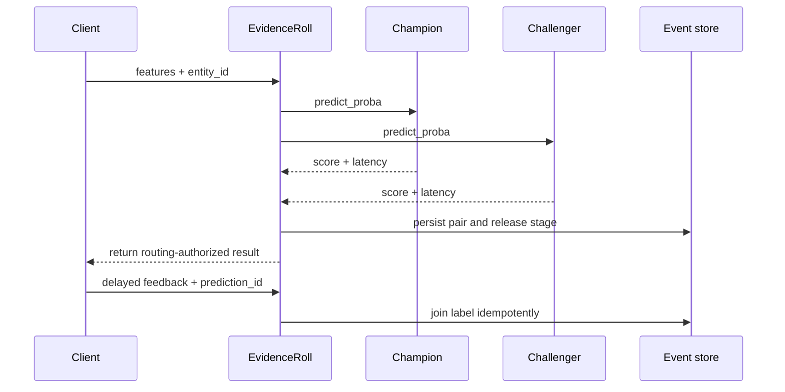
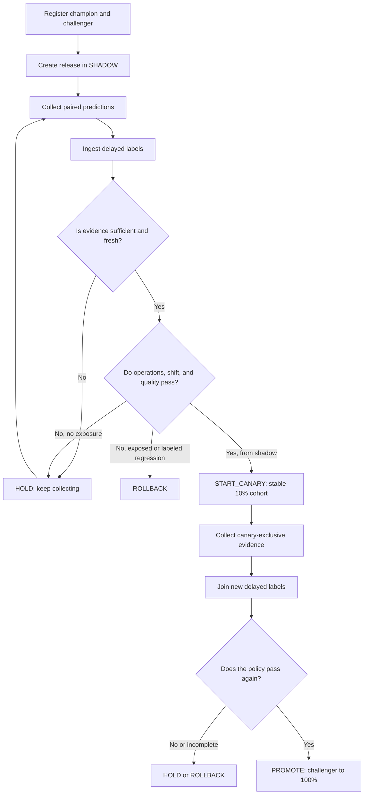

# EvidenceRoll: Complete Project Walkthrough

## The problem it solves

Traditional applications can be evaluated during a canary rollout with HTTP error rates, latency,
and resource consumption. That is not enough for machine learning. A model can return `200 OK`,
stay fast, and still make worse decisions.

The risk becomes acute when ground truth arrives late. For example:

- churn may be confirmed weeks after it was predicted;
- a transaction chargeback may arrive days after a fraud decision;
- a loan outcome may be known months after approval;
- a conversion may happen long after a recommendation was shown.

During that gap, many delivery systems observe that the service did not fail and interpret silence
as success. EvidenceRoll introduces a stricter invariant: **absence of evidence is not evidence of
success; it is epistemic debt that must block promotion**.

## What the project does

EvidenceRoll sits in front of a champion model and a challenger model:

1. it receives each prediction request;
2. it runs the champion and challenger on the same input;
3. while in `shadow`, it returns only the champion result;
4. it stores both probabilities, decisions, latencies, features, and release stage;
5. it later receives ground truth through the original `prediction_id`;
6. it joins feedback to the prediction idempotently;
7. it computes sufficiency, freshness, coverage, shift, disagreement, quality, and calibration;
8. it evaluates a versioned policy;
9. it decides `HOLD`, `START_CANARY`, `PROMOTE`, or `ROLLBACK`;
10. it writes the decision to a verifiable audit chain and exposes it to Prometheus and Argo.

## Architecture diagram



## Prediction flow



During `shadow`, the routing-authorized result is always the champion. During `canary`, a stable hash
of `entity_id` selects the configured challenger percentage, keeping an entity in the same cohort
instead of switching it between models.

## Complete release workflow



## Evidence evaluated by the controller

| Dimension | Signal | Purpose |
|---|---|---|
| Sufficiency | minimum prediction count | prevents decisions from tiny samples |
| Coverage | labels divided by predictions | detects incomplete or selective feedback |
| Freshness | age of the newest labeled evidence | prevents promotion from stale windows |
| Operations | challenger p95 latency | protects service objectives even when quality improves |
| Data | maximum feature PSI | detects production shift from the reference profile |
| Change | champion/challenger disagreement | reveals how much behavior changes |
| Quality | paired accuracy delta and interval | compares both models on the same cases |
| Calibration | Brier score delta | detects less trustworthy probabilities |
| Governance | policy ID and digest | reconstructs exactly which rules made a decision |

PSI and disagreement are preventive signals, not automatic proof of harm. Once enough labels are
available, labeled evidence takes precedence when rejecting a regression.

## States and actions

- `SHADOW`: the challenger executes without affecting a user response.
- `CANARY`: a deterministic cohort receives the challenger.
- `PROMOTED`: the challenger becomes the fully served version.
- `ROLLED_BACK`: challenger exposure returns to zero and the release terminates.

`HOLD` is not an error. It means there is not yet a defensible basis for an irreversible decision.
That state is the core safety property of the system.

## Step-by-step verification

### 1. Prepare the environment

```bash
python -m venv .venv
source .venv/bin/activate
python -m pip install -e ".[dev]"
```

On Windows PowerShell, activate the environment with `.venv\Scripts\Activate.ps1`.

### 2. Run the healthy release

```bash
python -m evidenceroll.cli simulate --scenario healthy --reset
```

The first stage-specific batch moves the release from `shadow` to `canary`; the second finishes in
`promoted`. The JSON output includes metrics, reason codes, digests, and final state.

### 3. Prove that a model regression rolls back

```bash
python -m evidenceroll.cli simulate --scenario regressed --reset
```

The deliberately degraded challenger finishes in `rolled_back`. The service itself stays healthy;
labeled model quality, rather than a simulated HTTP failure, causes rejection.

### 4. Prove the central invariant

```bash
python -m evidenceroll.cli simulate --scenario missing-feedback --reset
```

The controller returns `hold` with `INSUFFICIENT_LABELS`. This demonstrates that “not known yet” was
not silently converted into “approved.”

### 5. Run the complete verification suite

```bash
./scripts/verify.sh
```

### 6. Start the control plane

```bash
python -m evidenceroll.cli init
python -m evidenceroll.cli serve
```

Open `http://localhost:8080` for the operational dashboard or
`http://localhost:8080/docs` for the OpenAPI interface.

## Connecting real systems

The bundled scikit-learn models are deterministic acceptance fixtures, so the entire lifecycle can
be executed without an account or secret. A real installation registers `generic_http` or
`kserve_v2` endpoints. Credentials are resolved from environment variables and never stored in the
model manifest.

Argo Rollouts queries `/v1/argo/releases/{release_id}/analysis`:

- `Successful`: evidence authorizes progress;
- `Inconclusive`: the rollout must pause while evidence accumulates;
- `Failed`: the rollout must abort.

Prometheus scrapes coverage, shift, latency, decisions, and release state. Grafana dashboards and
alert rules are provisioned by `docker-compose.yml`.

## Engineering scope

The control plane covers the delivery layer around a model, not the training pipeline:

- inference and delayed-feedback contracts;
- champion/challenger evaluation and shadow traffic;
- progressive delivery and rollback;
- statistical and operational evidence;
- idempotency and concurrency control;
- reproducible policy decisions and tamper-evident auditing;
- FastAPI, Prometheus, Grafana, Docker, Kubernetes, Kustomize, and Argo Rollouts integration;
- unit, integration, failure-scenario, coverage, typing, packaging, and security checks;
- explicit architectural decisions, limitations, and incident runbooks.

The contribution is not another metric. It is turning **evidence sufficiency** into an enforceable
control-plane property.

## Explicit boundaries

Version `0.1.0` fully supports probabilistic binary classification with a single-writer control
plane. It does not claim global scale, regulatory certification, or real-world validity from the
bundled data. The benchmark is explicitly synthetic. High availability, distributed storage, and
additional model-task types are documented in the [roadmap](../ROADMAP.md) and
[ADR-003](adr/003-single-writer-store.md).
