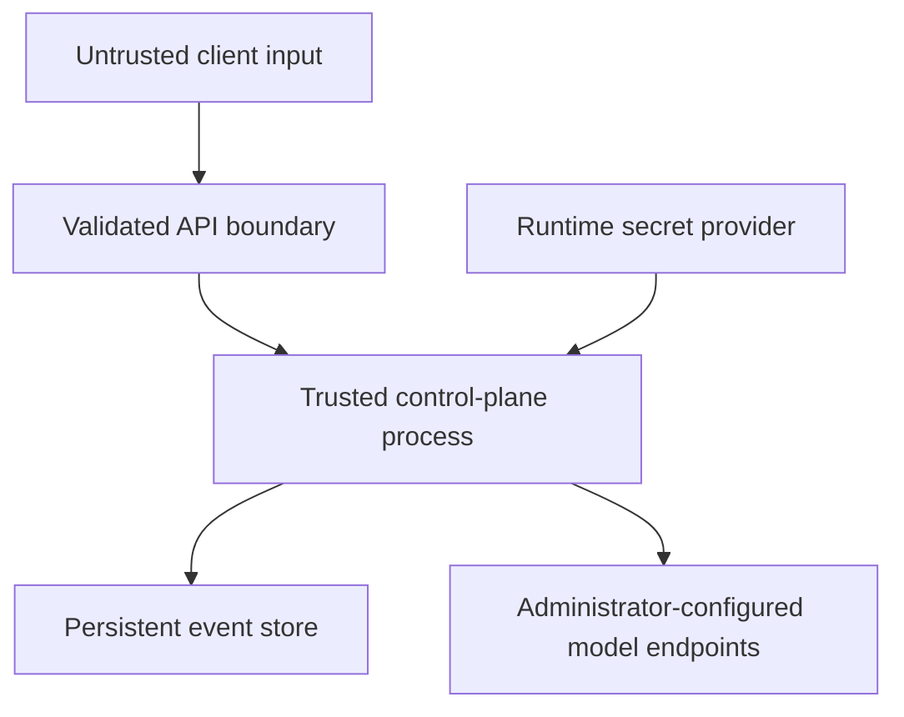

# Threat model

## Assets

- model endpoint credentials;
- release state and traffic weight;
- prediction/feedback linkage;
- policy and reference profile;
- model artifacts and manifest digests;
- decision evidence and audit-chain head.

## Trust boundaries

Endpoint URLs, registry metadata, policy files and runtime secrets are administrator-controlled.
Prediction features, entity IDs, idempotency keys and feedback are untrusted inputs.

## Threats and controls

| Threat | Control | Residual risk |
|---|---|---|
| unauthorized state mutation | optional API key, constant-time comparison, ingress recommended | one shared key is not tenant-aware IAM |
| credential disclosure | registry stores environment-variable name only | process/environment compromise exposes token |
| replayed prediction request | deterministic idempotency ID and body hash | callers must supply stable keys |
| conflicting feedback | unique prediction label and conflict response | an authorized source can still submit a wrong first label |
| model artifact replacement | SHA-256 checked before load | digest manifest can be replaced by same attacker |
| arbitrary joblib deserialization | artifacts are admin-trusted and digest-checked | digest is integrity, not sandboxing or publisher identity |
| audit editing | hash chain; optional HMAC | DB+HMAC key compromise permits chain rewrite |
| stale reconciler overwrites new state | optimistic release revision | one writer remains the supported deployment |
| SSRF through endpoint registration | no public registration API; admin CLI/config only | compromised admin/configuration can target internal services |
| feature data leakage | local persistence and no feature-valued Prometheus labels | DB access exposes stored features; encryption is platform-owned |
| cardinality explosion | release/entity IDs are bounded; entity is not a metric label | many attacker-created release IDs can still grow series count |
| availability exhaustion | request validation, container limits, timeouts | no built-in rate limiting; enforce at ingress |

## Data handling

The example stores full validated feature vectors to calculate drift. Real deployments should classify
features, minimize retention, tokenize entity identifiers, encrypt volumes, and define deletion
requirements. Never send raw protected attributes to telemetry labels.

## Production requirements outside this repository

- TLS and workload identity at ingress/service mesh;
- secret-manager injection and rotation;
- volume/database encryption and backup;
- rate limiting and request-size enforcement;
- separate writer authorization for prediction and ground-truth sources;
- independent export of audit-chain heads;
- artifact signature/provenance validation before registry admission;
- retention and privacy controls suitable for the data jurisdiction.

